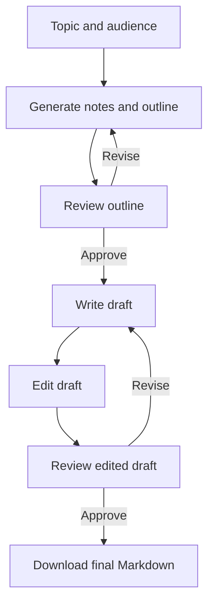

# BlogCraft Agent

Generate a Markdown blog post from a topic and audience. The workflow pauses for your approval of the outline and again after drafting and editing. You can request up to five revisions across both reviews. The final post is available to download after explicit approval.

The researcher uses model knowledge to suggest background and an outline. Review and verify factual claims before publication. Topic, audience, feedback, and generated content are sent to Groq as needed by the workflow.

## Run locally

Use Python 3.12 and uv. From the repository root, install the locked dependencies and create the local configuration file.

```sh
uv sync --locked
cp -n .env.example .env
```

Set `GROQ_API_KEY` in `.env`. Override `GROQ_MODEL` if needed. The default is `openai/gpt-oss-20b`.

```sh
uv run --locked python -m streamlit run app.py
```

For the interactive terminal version, run `uv run --locked python graph.py`.

## Workflow



## Project structure

```text
blogCraft_agent/
├── app.py                 # Streamlit entry point
├── graph.py               # CLI entry point
├── config.py              # Secrets, model settings, and input limits
├── agents/
│   ├── blog_agents.py     # Groq model and agent calls
│   └── prompts.py         # Research, writing, and editing prompts
├── workflow/
│   ├── graph.py           # LangGraph nodes and approval routing
│   ├── state.py           # Workflow state and review decisions
│   ├── run.py             # Session checkpoints and retries
│   └── service_errors.py  # User-facing provider error messages
├── ui/
│   ├── streamlit_app.py   # Web setup, review, and download screens
│   └── cli.py             # Interactive terminal interface
└── .streamlit/
    └── config.toml        # Streamlit settings
```

## Deploy on Streamlit Community Cloud

Use `app.py` as the entry point and Python 3.12. In **App settings → Secrets**, add `GROQ_API_KEY` as a top-level TOML entry. The web app checks Streamlit Secrets, environment variables, then local `.env`.

Blog progress stays in the current session. Download approved posts as Markdown to keep a copy. A public deployment lets visitors use the configured Groq quota.

If Groq times out, reaches its usage limit, or returns an incomplete response, the app shows an error and offers a retry from the pending workflow step.
